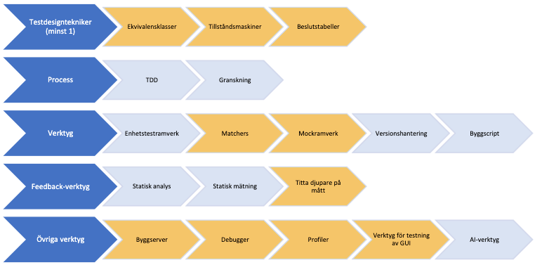

# Introduktion

Detta dokument innehåller förslag på uppgifter för projektet på INTE. Gruppen väljer själv vilket projekt den vill arbeta med, och vem som gör vilken del. Dessa val behöver inte anmälas i förväg, utan redovisas på det första redovisningstillfället. Om inget av idéerna passar står det gruppen fritt att komma med ett eget förslag. Sådana förslag måste dock godkännas av kursledningen i förväg.

För att ett förslag ska godkännas måste det vara av lämplig omfattning och komplexitet, samt innehålla både gemensamma och individuella delar. De individuella delarna måste också vara av sådan omfattning och komplexitet att alla gruppmedlemmar får möjlighet att applicera det som tagits upp under kursen.

Det finns inga explicita gränser för vad som är lämplig omfattning och komplexitet, utan det avgörs från fall till fall. Om allt som görs är att utveckla klass efter klass med enbart data och get och set-metoder spelar det ingen roll hur många klasser som tas fram. Det kommer inte att vara intressant att testa. Tänk också på att inte lägga all funktionalitet i samma klass, det är inte en objektorienterad lösning. Klasserna ska kombinera data och funktionalitet, och samarbeta för att lösa olika uppgifter som inte bara kräver enkla variabler och villkor. Det är också viktigt att de individuella delarna påverkar varandra så att versionshanteringssystemets konflikthantering kommer till nytta.

Oavsett om gruppen väljer en av de föreslagna projektidéerna eller kommer med sitt eget förslag är syftet att få fram något intressant för en utvecklare att testa, inte att utveckla ett klassbibliotek eller system. Det finns inga krav att allt blir klart, eller att alla varianter gås igenom.

## Ickefunktionella krav på uppgiften

Förutom de funktionella kraven på uppgiften, som ni i stor utsträckning bestämmer själva, så finns det också ett antal ickefunktionella krav. De flesta av dessa handlar om att ni ska använda specifika verktyg och tekniker och sammanfattas i figuren nedan. De ljust blå-gråa är obligatoriska att använda. För de gula gäller att gruppen måste välj (minst) tre av dem. Av dessa måste minst en vara en av testdesign-teknikerna. De ickefunktionella kraven diskuteras på projektintroduktionen.

Figuren i textform:

| Område | Obligatoriska (blå-gråa) | Välj minst tre totalt (gula) |
| --- | --- | --- |
| Testdesigntekniker (minst 1) | | Ekvivalensklasser · Tillståndsmaskiner · Beslutstabeller |
| Process | TDD · Granskning | |
| Verktyg | Enhetstestramverk · Versionshantering · Byggscript | Matchers · Mockramverk |
| Feedback-verktyg | Statisk analys · Statisk mätning | Titta djupare på mått |
| Övriga verktyg | AI-verktyg | Byggserver · Debugger · Profiler · Verktyg för testning av GUI |

## Dependency injection

Dependency injection är en vanlig teknik för att öka testbarheten hos något. Denna teknik kombineras ofta ihop med test doubles (tex stubbar eller mock-objekt), och är något som ni bör testa på att använda er av. Det är en mycket vanlig teknik i verkliga projekt, och kan med fördel användas till exempel när man vill undvika att testa med riktiga filer, internetuppkopplingar eller databaser. Flera av uppgifterna har förslag på var man kan tillämpa detta.

## Designmönster

På flera av uppgiftsförslagen finns det också tips om att olika designmönster kan vara lämpliga att använda. Det finns inget krav på att ni verkligen implementerar funktionerna med hjälp av dessa designmönster, men det kan bidra till att göra uppgiften mer realistisk och mer intressant ur testsynvinkel. De vanligaste referenserna är till Decorator[^decorator] och Visitor[^visitor], men även Observer[^observer] (Listener) är av intresse på många ställen. En teknik som också kan vara relevant om ni har klasshierarkier är Double dispatch[^double-dispatch].

> [!WARNING]
> Slutligen: undvik Singelton[^singleton]. De är svåra att testa, och kan vara mycket svåra att få bort om man kommer på att det skulle behövas flera.

## Granskning

Det är en mycket stark rekommendation att den obligatoriska granskningen görs på en annan grupps kod. Undantag från detta måste diskuteras och motiveras vid någon av de obligatoriska statusredovisningarna.

## Restorsaker

Erfarenheten från tidigare år är att de flesta grupperna brukar göra ett bra jobb på projektet, men naturligtvis händer det att grupper eller individer får rest. De flesta rester är små, men för säkerhets skull kommer här en snabb sammanfattning de vanligaste orsakerna så att ni kan undvika dem.

**På individnivå** beror rester nästan alltid på att någon inte deltagit fullt ut. Detta brukar märkas ganska tydligt vid redovisningen av projektet. Vanliga indikatorer är betydligt färre commits än resten av gruppen och/eller en brist på intressanta exempel. Det kan också vara så att man inte klarar av att delta i diskussionen vid seminariet.

Ofta beror problem på individnivå på att man har implementerat något som är för enkelt, dvs inte innehåller tillräckligt mycket funktionalitet som är intressant att testa. En annan orsak är att man inte tillämpat TDD fullt ut. Man måste kunna visa att man gjort alla stegen, inklusive refaktorering.

**På gruppnivå** beror rester nästan alltid på att gruppen inte kan visa att man uppfyllt de icke-funktionella kraven. Det räcker till exempel inte med att en person i gruppen har startat en debugger för att man ska kunna pricka av detta icke-funktionella krav. Hela gruppen ska vara delaktig och nivån på användningen måste vara tillräcklig. Vid osäkerhet: fråga!

**Testdesignteknikerna:** Problem med testdesignteknikerna beror nästan alltid på att man försökt pressa in det i slutet istället för att planera för det från början. De måste tillämpas på intressanta exempel, annars kommer det aldrig att bli något av det.

**Presentationen:** Tänk också på att presentationen ni lägger upp i ilearn ska gå att tolka självständigt. Det ska alltså inte bara vara ett presentationsmaterial, utan också innehålla tillräckligt mycket text för att det ska gå att följa med.

---

# Kassasystem

Denna uppgift är lämplig för grupper på tre till fem personer, den är betydligt renare än den föregående, men kan upplevas som lite tråkigare eftersom den är mer styrd av hur denna typ av system fungerar i verkligheten.

Uppgiften går ut på att implementera klasser som skulle kunna användas i ett kassasystem med varor, kvitton, rabatter, kunder, etc.

- **Testdesigntekniker:** Samtliga testdesigntekniker går att applicera i denna typ av projekt. Vilka som är lämpligast beror på exakt vad man gör.
- **Profiler:** En profiler kan vara intressant om man vill studera hur någon del av systemet klarar stora mängder data, eller vid generering av rapporter som ställer samman större datamängder.
- **Användarinterface:** Till skillnad från rougelike-förslaget kan det här eventuellt vara intressant att utveckla en liten del av ett användarinterface, eller åtminstone något som kopplar ihop de olika delarna, dock absolut inte hela kassasystemet.

## Förslag på uppdelning

Nedanstående lista innehåller förslag på funktioner som kan implementeras. Några av dessa, som **pengar och varor är absolut nödvändiga**, och är lämpliga att utveckla tillsammans för att komma igång i projektet. Därefter kan varje person välja ett antal funktioner och gruppen jobba mer distribuerat.

Det går inte att säga exakt hur många funktioner man ska ta per person eftersom detta beror på deras komplexitet. Tänkt dock på att varje person måste ha tillräckligt mycket intressant funktionalitet, och också möjlighet att interagera med andra deltagares kod.

> [!IMPORTANT]
> Det är också viktigt att arbeta objektorienterat. Rabatter till exempel ska inte räknas ut av kvittoklassen, även om den säkert ansvarar för att samla ihop dem.

### Översikt

| Område | Funktioner |
| --- | --- |
| Grund | [Pengar](#pengar) · [Valutor](#valutor) · [Varor](#varor) |
| Varor och kategorier | [Varugrupper](#varugrupper) · [Momskategorier](#momskategorier) · [Pant](#pant) · [Åldersgränser](#åldersgränser) · [Leverantörer](#leverantörer) |
| Kvitto och kassa | [Kvitton](#kvitton) · [Kassan](#kassan) · [Växel](#växel) |
| Hårdvara och identifiering | [EAN/GTIN](#eangtin) · [Scanning](#scanning) · [Våg](#våg) |
| Rabatter | [Enkla rabatter](#enkla-rabatter) · [Mer komplicerade rabatter](#mer-komplicerade-rabatter) · [Bara en rabatt](#bara-en-rabatt) |
| Lager | [Lagersaldo](#lagersaldo) |
| Kunder och medlemskap | [Kunder](#kunder) · [Medlemskap](#medlemskap) · [Återbäring](#återbäring) · [Poäng](#poäng) · [Bonuscheckar](#bonuscheckar) · [Presentkort](#presentkort) · [Riktad reklam](#riktad-reklam) |
| Personal | [Personal](#personal) |
| Köpflöde och betalning | [Återköp](#återköp) · [Uppdelat köp](#uppdelat-köp) · [Parkera köp](#parkera-köp) |
| Loggning och rapporter | [Loggning](#loggning) · [Rapporter](#rapporter) |

---

### Pengar

I princip det som gjordes när vi gick igenom TDD. En klass som representerar pengar.

### Valutor

En möjlig utökning av ovanstående så att systemet stödjer flera valutor. Kan ge intressanta effekter om man tänker på växelkurser, och vad som ska hända om kunden inte betalar med ett exakt belopp. I vilken valuta ska kunden då få växel?

### Varor

Som ett minimum ett namn och ett pris. Antagligen också förmågan att presentera sig själv på något lämpligt sätt.

### Varugrupper

Samlingar av varor med något gemensamt, ofta använt i samband med rabatter, eller för att generera statistik. Man bör kunna lägga till och ta bort varor ur gruppen, samt iterera över den.[^iterable]

### Momskategorier

Olika varutyper har olika momssats som behöver räknas ut och redovisas på kvitton och eventuella relevanta rapporter.

### Pant

Vissa varor, till exempel många dryckesförpackningar, har en separat pant som läggs på utöver priset, och som man (rimligen) inte betalar moms eller får rabatt på.

### Åldersgränser

Vissa varor, som alkohol och tobak, får bara köpas av personer över en viss ålder. Detta är bara intressant om man implementerar själva kassan, annars blir det bara ett fält i varan eller varukategorin.

### Leverantörer

Egentligen samma sak som varugrupper, men kopplade till en viss leverantör.

### Kvitton

En samling med varor som automatiskt kan räkna ut pris. Funktioner man kan tänka sig är lägga till och ta bort varor, gruppera varor, sortera dem i bokstavsordning, samt naturligtvis skriva ut kvittot. Tänk på att samma vara kan läggas till och tas bort vid olika tillfällen.

Java har ett ganska enkelt interface för att skriva ut på en skrivare[^printing] som kan implementeras, och med fördel kan testas med hjälp av, till exempel, mock-objekt. Kvitton har normalt också datum och tid som kan testas med hjälp av test doubles.

Oavsett om man genererar kvittot i textform, som en bild, eller skriver ut det på riktigt, så måste man tänka på vad som händer om namnet på varan är för långt, och på att talen bör komma i prydliga kolumner. Formateringssträngar och fonter med fast bredd är användbara här. Fonter kan också ställa till problem eftersom dessa kan skilja sig åt mellan datorer och operativsystem.

Många av de andra funktionerna kan påverka kvittot, till exempel personen som sitter i kassan, kundens eventuella medlemskap, momssatser, etc.

### Kassan

En driver för många av de andra funktionerna. Exakt vad denna ska innehålla beror på vad man väljer att implementera, och det finns inga krav på att man överhuvudtaget gör denna.

### Växel

Om kunden betalar kontakt ska systemet lämna växel med minsta antal sedlar och mynt. Idag hanteras detta ofta av automtiska system, vad händer med ett sådant om det inte finns tillräckligt mycket av en valör? I vissa fall kan man ge fler av en lägre valör, i andra inte.

### EAN/GTIN

En naturlig utökning av varuklassen skulle vara en klass som representerar streckkodens GTIN (Global Trade Item Number).[^ean] Validering av kontrollsiffran är en funktion här.

Generering av den associerade streckkoden skulle kunna vara en intressant utökning, och kan göras antingen till en bild eller till en skrivare.

### Scanning

Scanning av varorna är det vanliga sättet att registrera köp. Ni har inte tillgång till en scanner, så att försöka lägga till en sådan funktionalitet skulle kunna vara ett intressant exempel på hur man testar interaktion med något som ännu inte är implementerat med hjälp av interface och test doubles.

Tänk på att scanning inte alltid lyckas.

### Våg

En variant av ovanstående är att kunna väga varor. Detta skulle också få in en ny typ av varor där priset är per viktenhet istället för per styck.

Tänk på att olika varor använder olika viktenheter. Saffran mäts i gram, godis i hekto, frukt och grönsaker i kilo och grus i ton.

### Enkla rabatter

Enkla rabatter är sådana som ger ett visst belopp eller en viss procentsats i rabatt. De kan vara kopplade till hela köpet, en viss vara eller en varugrupp. Nästan alltid har de en giltighetstid som kan testas med hjälp av dependency injection.

Ett designmönster som kan vara intressant här är **Decorator**.

### Mer komplicerade rabatter

Mer komplicerade rabatter är till exempel:

- tag 3 betala för 2
- rabatter som bara gäller max 2 köp per kund
- rabatter som kräver att kunden handlat över ett visst belopp med eller utan den rabatterade varan
- att det är en speciell tid på dagen och kanske bara gäller vissa kunder, så som pensionärsrabatter dagtid vissa dagar, eller happy hour.

### Bara en rabatt

Oavsett vilka rabatter man har brukar det i de flesta fall vara så att max en rabatt kan tillämpas på en viss vara, och då är det viktigt att det är den som ger högst rabatt som används.

I vissa fall kan detta bli ganska komplicerat, speciellt om det finns vissa varor som ingår i flera rabatterbjudanden, eller om det finns rabatter som gäller hela köpet samtidigt som det finns rabatter på vissa varor. I det senare fallet kan det i vissa fall vara bättre att räkna bort den rabatterade varan om rabatten på hela köpet är högre.

### Lagersaldo

En naturlig utökning av ett kassasystem är att också hålla reda på lagersaldot för varorna i butiken, och automatiskt uppdatera detta när någonting köps.

### Kunder

Namn, adress, personnummer, telefonnummer, e-postadress. Ju mer information vi har om kunderna desto bättre. Självklart vill vi också hålla reda på vad varje kund handlar så att vi kan generera statistik och riktad reklam.

> [!TIP]
> Ett tips är dock att inte försöka få in all information ni kan komma på i klassen. Det är lätt att det blir för stort fokus på kvantitet istället för kvalitet. Välj ut delar som blir intressanta ur testsynvinkel, eller som är nödvändiga för andra funktioner.

### Medlemskap

Många affärskedjor erbjuder medlemskap till sina kunder. Dessa ger ofta någon typ av fördel för kunden, samtidigt som de tillåter affären att samla in betydligt mer information om kunden och dennes köp.

Medlemskap kan också vara tidsbegränsade, kosta pengar, ha en minimiålder, etc.

### Återbäring

En fördel som kan finnas med ett medlemskap är direkt återbäring, där medlemmen får tillbaka en del av köpesumman. Detta kan ske när kunden handlat för tillräckligt mycket inom en viss tid, eller med viss periodicitet. Självklart är det viktigt att köp man redan fått återbäring på inte räknas med nästa gång återbäringen ska betalas ut.

Ibland finns det också olika nivåer på återbäring beroende på hur mycket man har handlat för eller vilken typ av medlemskap man har. Vissa kategorier av varor kan vara uteslutna ur återbäringsprogram, till exempel lotter och presentkort.

### Poäng

En variant på återbäring är att man istället samlar poäng som sen kan bytas in mot varor eller presentkort.

En typ av erbjudande som ibland förekommer är att medlemmar får dubbla poäng under en viss period, eller på vissa varor eller kategorier.

### Bonuscheckar

En sak som ofta kan köpas för poäng är bonuscheckar som sen kan användas för att helt eller delvis betala ett köp. Dessa räknas normalt inte som rabatter, så man kan betala ett köp med flera bonuscheckar, och eventuella rabatter ska appliceras.

En möjlig begränsning är att man inte får ut något av värdet för en bonuscheck i kontanter, så att de alltså inte ger någon växel om man betalar för mycket.

### Presentkort

En annan form av alternativt betalningsmedel är presentkort. Dessa är varor, men räknas aldrig med i rabatter eller bonussystem, och måste ibland aktiveras för att vara giltiga. De har normalt en tidsgräns för hur länge de får användas.

### Riktad reklam

En viktig anledning till medlemskap är möjligheten att generera riktad reklam som är anpassad efter vilka varor eller varukategorier som kunden brukar köpa, ålder, kön, adress, etc.

### Personal

Kassasystem har normalt information om vem som satt i kassan vid en viss tidpunkt. Detta är absolut relevant, men behöver kompletteras med funktionalitet för att bli intressant i detta sammanhang. Annars blir det bara en klass till och ett fält i kvitto-klassen.

Möjligheter:

- Hålla reda på hur många varor varje medlem av kassapersonalen kan hantera per tidsenhet. En ofta kritiserad funktion i denna typ av system.
- Införa någon typ av bonussystem som är beroende av hur mycket personen har sålt under månaden eller året.

### Återköp

Ibland är inte kunder nöjda med ett köp utan vill göra ett återköp av hela eller delar av det. Detta påverkar många av de tidigare uppräknade funktionerna, till exempel lagerhållning, återbäring och poäng. Om varan ingått i en grupp av varor som kunden fått rabatt för måste detta också tas hänsyn till, samma sak o man har återbäring eller poängsystem.

### Uppdelat köp

Det finns många sätt att betala på: kontanter, kort, Swish, poäng, bonuscheckar, presentkort, etc. Speciellt med de sistnämnda är det vanligt att dessa bara täcker delar av ett köp, och att kunden vill använda andra betalningsmedel för resten.

### Parkera köp

Ett köp kan parkeras om kunden glömt något och vill gå tillbaka in i butiken eller hem och hämta plånboken. Detta är bara relevant om man faktiskt bygger själva kassan.

### Loggning

Väldigt mycket av vad som sker i ett system av denna typ loggas, antingen för att det finns lagkrav på det, eller för att kunna få ut information om hur systemet används. Detta kan göras i databaser eller filer, som kan testas med hjälp av test doubles.

### Rapporter

All den information som finns i systemet ger möjlighet att generera rapporter till olika delar av verksamheten. Dessa kan till exempel vara i html eller skrivas ut på skrivare. Alternativt kan man testa att generera diagram i html eller bildformat.

---

[^decorator]: [Decorator pattern](https://en.wikipedia.org/wiki/Decorator_pattern)
[^visitor]: [Visitor pattern](https://en.wikipedia.org/wiki/Visitor_pattern)
[^observer]: [Observer pattern](https://en.wikipedia.org/wiki/Observer_pattern)
[^double-dispatch]: [Double dispatch](https://en.wikipedia.org/wiki/Double_dispatch)
[^singleton]: [Singleton pattern](https://en.wikipedia.org/wiki/Singleton_pattern)
[^iterable]: [`java.lang.Iterable`](https://docs.oracle.com/en/java/javase/16/docs/api/java.base/java/lang/Iterable.html)
[^printing]: [Java Tutorial: Printing](https://docs.oracle.com/javase/tutorial/2d/printing/index.html)
[^ean]: [European Article Number (Wikipedia)](https://sv.wikipedia.org/wiki/European_Article_Number)
